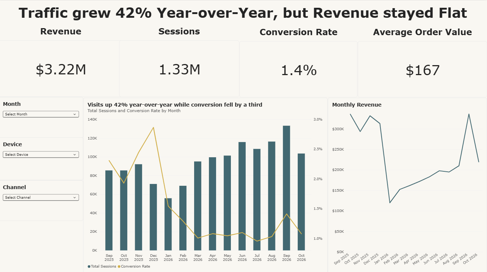
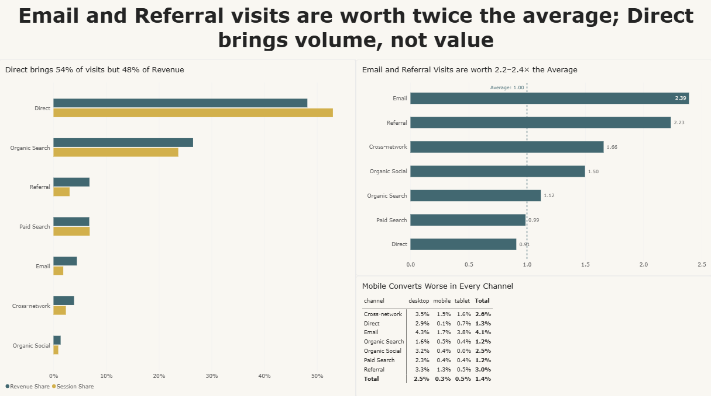
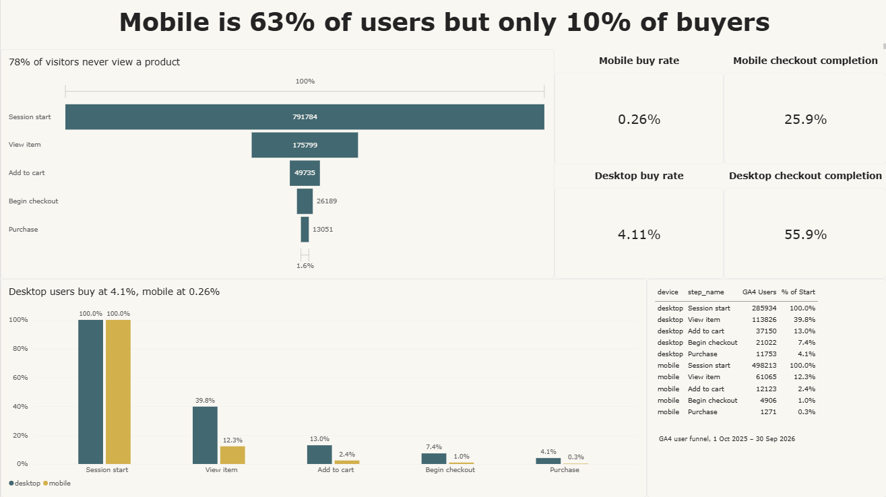
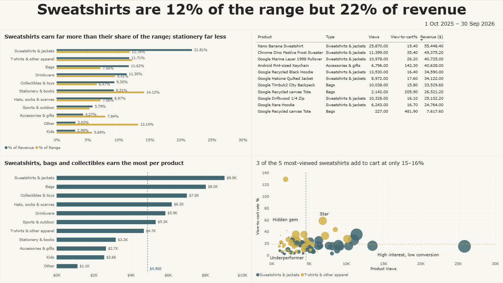

# GA4 E-Commerce Analytics: PostgreSQL to Power BI

Where does an online store lose buyers, and which channels, devices and products deserve more investment? An end-to-end analysis of recent Google Analytics 4 data from the Google Merchandise Store, using SQL (PostgreSQL) and a 5-page Power BI dashboard.

**Tools:** GA4 demo account, Looker Studio, PostgreSQL (pgAdmin), Power BI Desktop (DAX)

---

## Overview

### Problem statement
The Google Merchandise Store is a real, live e-commerce site. Between 1 October 2025 and 30 September 2026 (including the 2025 holiday season), where did the store lose buyers? Which channels, devices and products deserve more investment, and how did the holiday season change buying behaviour?

### What we calculate and measure

| Area | Metric | Definition |
|---|---|---|
| Overall | Conversion rate | Purchases / sessions |
| Overall | Average order value | Revenue / purchases |
| Overall | Revenue per session | Revenue / sessions (the value of one visit) |
| Overall | Engagement rate | Engaged sessions / sessions |
| Channels | Session share vs revenue share | Each channel's share of traffic compared with its share of revenue |
| Channels | Value index | Revenue share / session share (above 1 = visits worth more than average) |
| Funnel | Step-to-step conversion | Share of users reaching the next step: session start, view item, add to cart, begin checkout, purchase |
| Funnel | Event funnel vs user funnel | Events from the traffic table compared with GA4's user-based funnel, to confirm the same leaky step shows up in both |
| Products | View-to-cart rate | Add-to-carts / product views |
| Products | Product groups | Star, High interest low conversion, Hidden gem, Underperformer (split on median views and median view-to-cart rate) |
| Products | Revenue per product | Revenue per product, by product type |
| Seasonality | Per-day averages | Holiday periods vs normal days (revenue, sessions, conversion rate per day) |
| Seasonality | Year-over-year change | Same calendar days in 2026 vs 2025 |
| Retention | Returning revenue share | Returning visitors' revenue / total revenue |

### Expected outputs
- Cleaned, validated PostgreSQL tables and six SQL scripts (`00` to `05`)
- A 5-page Power BI dashboard: Overview, Acquisition, Funnel, Products, Holiday and YoY
- A what-if checkout simulator estimating the extra buyers from improving checkout completion
- A one-page recommendation memo and a short results deck

### Data and scope
- **Source:** the public GA4 demo property "GA4 - Google Merch Shop" (read-only access for any Google account).
- **Coverage:** the demo property only keeps data from 20 August 2025, so the dataset runs from August 2025 to late October 2026. The analysis window is 1 Oct 2025 to 30 Sep 2026.
- **Consequence:** there is no 2024 holiday season to compare with. Holiday days are compared with normal days using per-day averages, and year-over-year is limited to September and October, the only months present in both years.
- **Aggregated data only:** raw events aren't available for the demo property, so the analysis uses aggregated exports (daily traffic, monthly product data and GA4's funnel).

---

## Data extraction steps

1. **Learn the GA4 interface.** Open the demo account, then note last month's sessions, purchases and revenue for the top channels and the top products. These numbers are later used to check the exports.
2. **Try the GA4 Data API (blocked).** A Python pull was tried first. Sign-in worked, but Google returned "This property is denied access to the API" for the demo property, so the API is not an option here.
3. **Export through Looker Studio instead.** Looker Studio's built-in GA4 connector works for the demo property.
   - `daily_traffic.csv`: dimensions Date, Session default channel group, Device category, New / returning; metrics Sessions, Engaged sessions, Add to carts, Checkouts, Ecommerce purchases, Purchase revenue.
   - `monthly_items.csv`: dimensions Year month, Item category, Item name; metrics Items viewed, Items added to cart, Items purchased, Item revenue.
   - Export each table with Export chart, then Export data, then CSV.
   - Don't save the files from Excel: it reformats dates and numbers.
4. **Build the funnel table by hand.** The demo account hides the export button on Explorations, so GA4's funnel (session start, view item, add to cart, begin checkout, purchase, broken down by device, open funnel, 1 Oct 2025 to 30 Sep 2026) is copied into `funnel_ga4.csv`: 5 steps x 5 device rows (Total, desktop, mobile, tablet, smart tv) = 25 rows.

Why two funnels: the traffic table counts events (one person adding three items counts three times), while GA4's funnel counts users. If both point to the same leaky step, the finding is solid.

---

## SQL steps (PostgreSQL)

Run the scripts in order in pgAdmin's Query Tool.

| Script | What it does |
|---|---|
| `00_raw_tables.sql` | Creates empty text-only "raw" tables that mirror the CSVs, so the import can never fail on a date or number format. Then import the three CSVs (header on). |
| `01_load.sql` | Converts raw text into clean typed tables (`traffic`, `items`, `funnel_ga4`) with a `to_num()` helper. Dates in several formats are parsed with regex-guarded `CASE` branches (Excel resaving had changed some). Ends with data quality checks: unparsed dates, date coverage, unknown values, and a reconciliation against the GA4 interface. |
| `02_channels.sql` | Builds `channel_summary`: share of sessions vs share of revenue per channel, revenue per session, and the best-converting device within each channel. |
| `03_funnel.sql` | Builds `funnel` (event funnel from the traffic table) and the step-to-step conversion by device from GA4's user funnel. |
| `04_products.sql` | Builds `product_summary` (grouped by product name only, because GA4 tags views and purchases of the same product with different categories) and `product_groups` (median-based Star / High interest, low conversion / Hidden gem / Underperformer). Product types come from product-name keywords, because GA4's category labels are unreliable. |
| `05_seasonality.sql` | Builds `monthly` with month-over-month change, compares holiday periods with normal days on a per-day basis, year-over-year for the overlapping months, and the returning-visitor share of revenue. |

SQL techniques used: CTEs, window functions (`LAG`, `RANK`, `ROW_NUMBER`, `FIRST_VALUE`, `SUM() OVER`), `CASE`, `FILTER`, `PERCENTILE_CONT` (median), `NULLIF`, regex date parsing.

Data quality checks before any analysis: row counts, date coverage (no missing days), unknown or "(not set)" values, and one month reconciled against the GA4 interface.

---

## Power BI steps

### 1. Connect and model
1. Power BI Desktop, then Get Data, then PostgreSQL database (server `localhost`, database `ga4_project`, Import mode).
2. Load the analysis tables (`traffic`, `funnel`, `funnel_ga4`, `product_groups`, `monthly`). Don't load the `raw_` tables.
3. Check column types in Transform Data (dates as Date, revenue as Decimal number).
4. Create a `Calendar` table with `CALENDAR(DATE(2025,8,1), DATE(2026,10,31))`, add Year / Month / MonthNum columns, link `Calendar[Date]` to `traffic[dt]` (one-to-many) and mark it as the date table.

### 2. Core DAX measures
Measure names start with "Total" so they don't clash with column names, which Power BI treats case-insensitively.

- `Total Sessions`, `Total Purchases`, `Total Revenue`
- `Conversion Rate`, `Avg Order Value`, `Revenue per Session`, `Engagement Rate` (all with `DIVIDE`)
- `Returning Revenue Share` (`CALCULATE` with a returning-visitor filter)
- Year-over-year: `Revenue LY`, `Revenue YoY %`, `Sessions LY`, `Sessions YoY %`, `Conversion Rate LY` (`SAMEPERIODLASTYEAR`)
- Acquisition: `Session Share`, `Revenue Share`, `Value Index` (`ALL` / `REMOVEFILTERS`)
- Funnel: `GA4 Users`, `% of Start`
- Calendar columns for holiday periods and per-day comparisons

### 3. Dashboard pages
Each page is titled with its finding rather than its topic.

| Page | Question | Main visuals |
|---|---|---|
| 1. Overview | How is the store performing overall? | KPI cards (sessions, revenue, conversion rate, AOV), monthly trend lines, date slicer |
| 2. Acquisition | Which channels bring valuable visits, not just volume? | Session share vs revenue share by channel, value index with a reference line at 1, conversion rate by channel and device matrix |
| 3. Funnel | Where are buyers lost? | User funnel (total), funnel by device, buy rates for mobile vs desktop, checkout what-if slider |
| 4. Products | Which products and product types earn their place in the range? | Revenue and range share by product type, product groups, top products |
| 5. Holiday and YoY | What did the holiday season change, and how is the store trending? | Revenue and conversion per day, holiday vs normal days, year-over-year for the overlapping months, returning revenue share |

### 4. What-if checkout simulator
A what-if parameter lets the viewer set a target checkout completion rate. It recalculates projected purchases and extra revenue from the funnel table: `Projected Purchases` and `Extra Revenue` measures driven by the parameter value.

---

## Dashboard preview (work in progress: pages 1 to 4 of 5 so far)

**Page 1: Overview**



**Page 2: Acquisition**



**Page 3: Funnel**



**Page 4: Products**



The Holiday and YoY page is still being built. The `.pbix` file will be updated as they are finished.

---

## Repository contents

```
ga4-ecommerce-analytics/
  README.md
  data/
    funnel_ga4.csv             GA4 user funnel (25 rows, copied by hand from a GA4 exploration)
  sql/
    00_raw_tables.sql          staging tables for the CSV imports
    01_load.sql                cleaning + data quality checks
    02_channels.sql            channel analysis
    03_funnel.sql              funnel analysis
    04_products.sql            product types and product groups
    05_seasonality.sql         holiday vs normal days, year-over-year, returning visitors
  powerbi/
    GA4_Analysis.pbix          Power BI report (pages 1-2 so far; pages 3-4 are in the screenshots)
    screenshots/
```

`daily_traffic.csv` and `monthly_items.csv` are not included yet. Re-export them from Looker Studio using the steps above.

*Findings and the remaining dashboard pages will be added as the project is finished.*
